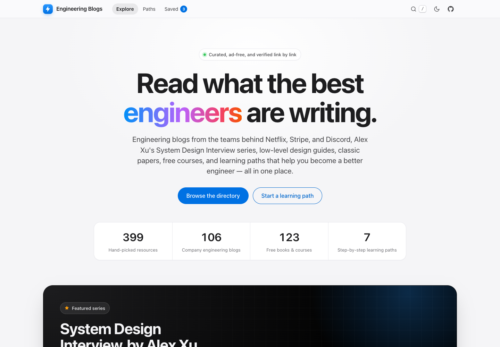
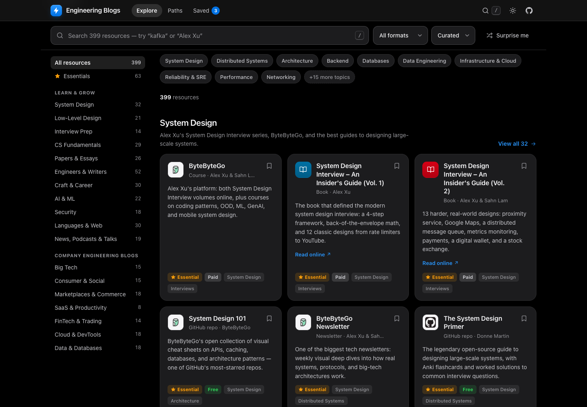
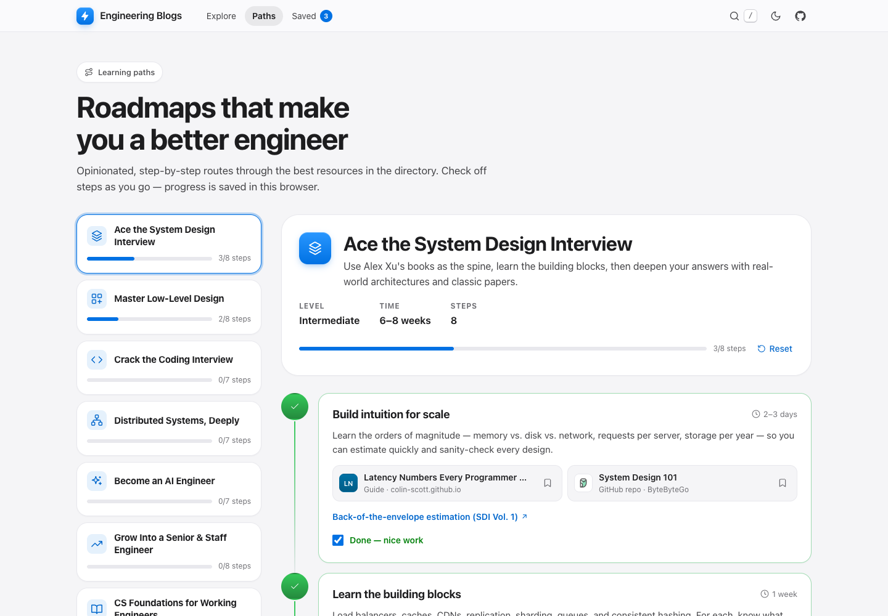
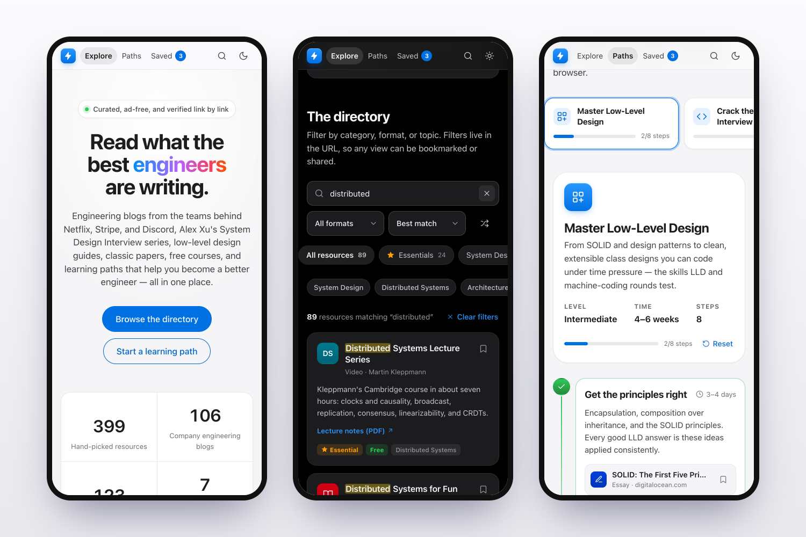

<div align="center">


# Engineering Blogs

**Read what the best engineers are writing.**

A curated, link-checked library of **399 resources**: company engineering blogs, Alex Xu's _System Design Interview_
series, low-level design guides, classic papers, free courses, and step-by-step learning paths, for anyone who wants to
become a better engineer.

[**Open the live site →**](https://da-gohil.github.io/eng-blogs/)
&nbsp;·&nbsp; [Suggest a resource](https://github.com/da-gohil/eng-blogs/issues/new?template=suggest-resource.yml)
&nbsp;·&nbsp; [Report a broken link](https://github.com/da-gohil/eng-blogs/issues/new?labels=broken-link)

[](https://github.com/da-gohil/eng-blogs/actions/workflows/deploy.yml)
[](https://github.com/da-gohil/eng-blogs/actions/workflows/links.yml)



</div>

## What's inside

| Category | Resources | Highlights |
| --- | ---: | --- |
| **Learn & grow** | | |
| System Design | 32 | ByteByteGo, System Design Interview Vol. 1 & 2, System Design 101, The System Design Primer, DDIA |
| Low-Level Design | 21 | Object-Oriented Design Interview, Head First Design Patterns, Refactoring.Guru, Awesome LLD, Hello Interview LLD |
| Interview Prep | 14 | Tech Interview Handbook, Coding Interview Patterns, NeetCode, Grind 75 |
| CS Fundamentals | 29 | The Missing Semester, OSTEP, CMU 15-445 Databases, MIT 6.5840 Distributed Systems |
| Papers & Essays | 26 | Dynamo, Raft, Lamport's _Time, Clocks_, _The Log_, Spanner, Attention Is All You Need |
| Engineers & Writers | 52 | Martin Fowler, Dan Luu, Julia Evans, Marc Brooker, Simon Willison, Jepsen |
| Craft & Career | 30 | The Pragmatic Engineer, StaffEng, Google's code review guide, _You and Your Research_ |
| AI & ML | 22 | Anthropic Engineering, Hugging Face, Karpathy's Zero to Hero, Chip Huyen's _AI Engineering_ |
| Security | 18 | Google Project Zero, PortSwigger Web Security Academy, Trail of Bits, OWASP |
| Languages & Web | 30 | MDN, web.dev, The Go Blog, The Rust Book, Inside.java, V8 |
| News, Podcasts & Talks | 19 | Hacker News, Lobsters, InfoQ, ACM Queue, Signals and Threads |
| **Company engineering blogs** | | |
| Big Tech | 15 | Netflix, Meta, Google Research, AWS Architecture, LinkedIn, NVIDIA |
| Consumer & Social | 15 | Discord, Spotify, Pinterest, X (Twitter), Reddit, JioHotstar |
| Marketplaces & Commerce | 18 | Uber, Airbnb, Shopify, Lyft, DoorDash, Grab, Flipkart |
| SaaS & Productivity | 8 | Slack, Figma, Notion, Dropbox, Canva, Linear |
| FinTech & Trading | 14 | Stripe, Jane Street, Square, Cash App, Monzo, Nubank, Razorpay |
| Cloud & DevTools | 18 | Cloudflare, GitHub, Fly.io, Tailscale, Datadog, Temporal |
| Data & Databases | 18 | PlanetScale, Cockroach Labs, Confluent, Databricks, ClickHouse, DuckDB |

Of the 399, there are 197 blogs, 46 books, 33 guides, 23 courses, 21 papers, 16 newsletters, 15 essays,
14 practice platforms, 12 video channels, 12 GitHub repos, 7 podcasts, and 3 communities. **63 are marked _Essential_**,
123 are completely free, and many blogs come with hand-picked "start with" posts.

### Featured: _System Design Interview_ by Alex Xu

The complete ByteByteGo bookshelf, with a link to buy each book and a link to read it online:

| Book | Authors | Links |
| --- | --- | --- |
| System Design Interview (Vol. 1) | Alex Xu | [Amazon](https://www.amazon.com/dp/B08CMF2CQF) · [Read online](https://bytebytego.com/courses/system-design-interview) |
| System Design Interview (Vol. 2) | Alex Xu & Sahn Lam | [Amazon](https://www.amazon.com/dp/1736049119) · [Read online](https://bytebytego.com/courses/system-design-interview) |
| Coding Interview Patterns | Alex Xu & Shaun Gunawardane | [Amazon](https://www.amazon.com/dp/1736049135) · [Read online](https://bytebytego.com/courses/coding-patterns) |
| Object-Oriented Design Interview | Fawaz Bokhari, Alex Xu & Desmond Zhou | [Amazon](https://www.amazon.com/dp/173604916X) · [Read online](https://bytebytego.com/courses/object-oriented-design-interview) |
| Machine Learning System Design Interview | Ali Aminian & Alex Xu | [Amazon](https://www.amazon.com/dp/1736049127) · [Read online](https://bytebytego.com/courses/machine-learning-system-design-interview) |
| Generative AI System Design Interview | Ali Aminian & Hao Sheng | [Amazon](https://www.amazon.com/dp/1736049143) · [Read online](https://bytebytego.com/courses/genai-system-design-interview) |
| Mobile System Design Interview | Manuel Vicente Vivo | [Amazon](https://www.amazon.com/dp/1736049151) · [Read online](https://bytebytego.com/courses/mobile-system-design-interview) |

Free from ByteByteGo: the [System Design 101](https://github.com/ByteByteGoHq/system-design-101) repo, the
[newsletter](https://blog.bytebytego.com/), and the [YouTube channel](https://www.youtube.com/@ByteByteGo).

### Learning paths

Ordered roadmaps through the catalog. Check off steps as you go, and your progress is saved in your browser.

1. **[Ace the System Design Interview](https://da-gohil.github.io/eng-blogs/?view=paths&path=system-design-interview)** (Intermediate · 6–8 weeks · 8 steps). Alex Xu's books as the spine, then the building blocks, real-world architectures, and classic papers.
2. **[Master Low-Level Design](https://da-gohil.github.io/eng-blogs/?view=paths&path=low-level-design)** (Intermediate · 4–6 weeks · 8 steps). SOLID, the core design patterns, a repeatable LLD framework, classic problems, concurrency, and timed mock rounds.
3. **[Crack the Coding Interview](https://da-gohil.github.io/eng-blogs/?view=paths&path=coding-interview)** (Beginner → Intermediate · 6–10 weeks · 7 steps). Patterns instead of memorized problems, plus OOD, behavioral, and negotiation.
4. **[Distributed Systems, Deeply](https://da-gohil.github.io/eng-blogs/?view=paths&path=distributed-systems)** (Advanced · 3 months · 7 steps). The theory, the papers, implementing Raft yourself, and how real systems fail.
5. **[Become an AI Engineer](https://da-gohil.github.io/eng-blogs/?view=paths&path=ai-engineer)** (Intermediate · 8–12 weeks · 7 steps). From backpropagation to transformers to shipping LLM products with evals.
6. **[Grow Into a Senior & Staff Engineer](https://da-gohil.github.io/eng-blogs/?view=paths&path=senior-staff)** (All levels · Ongoing · 8 steps). Design judgment, clear writing, visible impact, and habits that compound.
7. **[CS Foundations for Working Engineers](https://da-gohil.github.io/eng-blogs/?view=paths&path=cs-foundations)** (Beginner → Intermediate · Self-paced · 8 steps). Tools, operating systems, networks, databases, and algorithms, all with free material.

## Features

- **Instant search** across names, descriptions, authors, topics, and domains, with match highlighting. Press <kbd>/</kbd> or <kbd>⌘K</kbd> anywhere.
- **Filters in the URL.** Category, format, topics, and sort are kept in the query string (`?q=kafka&cat=data`), so every view can be bookmarked and shared, and the back button works.
- **Saved reading list.** Bookmark anything and export the list as Markdown. It's stored only in your browser.
- **Learning-path progress.** Check off steps; progress persists across visits.
- **Apple-inspired design.** SF Pro type, Apple's `#f5f5f7`/`#1d1d1f` palette, blue pill buttons, a true-black dark mode, and
  iOS-style icon tiles. It follows your OS light/dark setting, with a manual toggle.
- **Fast.** HTML is prerendered (content appears before JavaScript loads), logos are self-hosted, there are no web fonts, and the JS is about 125 KB gzipped.
- **Accessible.** Semantic landmarks, a skip link, full keyboard support, visible focus, ARIA states, reduced-motion support, and AA color contrast.
- **Link-checked.** A weekly GitHub Action tests all ~470 links and opens an issue when something breaks.
- **Private.** No analytics, cookies, ads, or third-party requests at runtime.

| Dark mode | Learning paths |
| --- | --- |
|  |  |



## Quick start

Requires **Node.js 22.12+** (CI uses Node 24, pinned in [`.nvmrc`](.nvmrc)).

```bash
git clone https://github.com/da-gohil/eng-blogs.git
cd eng-blogs
npm install
npm run dev          # http://localhost:5173
```

To test the real production output (prerendered HTML, 404 page, robots.txt):

```bash
npm run build
npm run preview      # http://localhost:4173
```

## Deploy to GitHub Pages

The repo includes [`.github/workflows/deploy.yml`](.github/workflows/deploy.yml). It lints, tests, builds, and publishes
the site on every push to `main`.

1. Push the repository to GitHub. GitHub Pages is free for public repositories.
2. Open **Settings → Pages → Build and deployment** and set **Source** to **GitHub Actions**.
3. Push to `main`, or run **Actions → Deploy to GitHub Pages → Run workflow**. About a minute later the site is live at
   `https://<user>.github.io/<repo>/`.

You don't need to configure a base path: the build uses relative URLs, so the same output works on project pages
(`/eng-blogs/`), user pages, and custom domains. The workflow automatically passes the site's absolute URL (for
canonical and Open Graph tags and `sitemap.xml`) and the repository URL (for the "Suggest a resource" and GitHub links).

- **Custom domain:** add it under **Settings → Pages**. The next deploy picks up the new URL automatically.
- **Other hosts** (Netlify, Vercel, Cloudflare Pages): use build command `npm run build` and output directory `dist`.
  Set `SITE_URL` and `VITE_REPO_URL` as build environment variables.

## Add or edit a resource

Each category has its own file in [`src/data/resources/`](src/data/resources), named after the category id. An entry looks like this:

```js
{
  id: "figma",                                   // unique kebab-case id (bookmarks use it, so keep it stable)
  name: "Figma Engineering",
  url: "https://www.figma.com/blog/engineering/",
  type: "blog",                                  // blog · newsletter · book · course · guide · repo · paper
                                                 // article · video · podcast · practice · community
  topics: ["frontend", "databases"],             // ids from TOPICS in src/data/taxonomy.js
  description: "Multiplayer editing, WebAssembly rendering, and horizontally sharding Postgres.",

  // Optional
  featured: true,                                // shows the "Essential" badge and sorts first
  cost: "free",                                  // free · freemium · paid (books, courses, platforms)
  author: "Will Larson",
  logo: "figma.com",                             // domain to take the logo from, or false for a monogram
  picks: [{ title: "How Figma's multiplayer technology works", url: "https://…" }],  // "Start with" posts
  links: [{ label: "Read online", url: "https://…" }],                              // alternate links
}
```

Then run:

```bash
npm run icons                         # fetch the logo for any new domain into public/icons/
npm test                              # validates every entry: ids, URLs, topics, references
npm run check:links -- --only=saas    # confirm the new links resolve
```

Learning paths live in [`src/data/paths.js`](src/data/paths.js), the Alex Xu spotlight in
[`src/data/spotlight.js`](src/data/spotlight.js), and categories, topics, and formats in
[`src/data/taxonomy.js`](src/data/taxonomy.js). See [CONTRIBUTING.md](CONTRIBUTING.md) for the curation guidelines.

## Scripts

| Command | What it does |
| --- | --- |
| `npm run dev` | Dev server with hot reload |
| `npm run build` | Production build, then prerender, then `404.html`, `robots.txt`, and `sitemap.xml` |
| `npm run preview` | Serve the production build locally |
| `npm run lint` | ESLint, including the React Hooks rules |
| `npm test` | 400+ tests: catalog integrity, search, URL state, progress, formatting |
| `npm run check` | Lint, test, and build. Run it before pushing |
| `npm run check:links` | Check every URL. Flags: `--only=<category>`, `--moved`, `--report=<file>` |
| `npm run icons` | Download logos for new domains. Flags: `--force`, `--prune` |

## How it works

- **Prerendered, then hydrated.** [`scripts/build.mjs`](scripts/build.mjs) bundles the app twice, once for the browser
  and once for Node. It renders the default view to static HTML and writes it into `dist/index.html`. Visitors see
  content immediately, crawlers see every link, and React hydrates the markup when the JavaScript arrives.
- **State in the URL.** A small external store ([`useAppState`](src/hooks/useAppState.js), built on
  `useSyncExternalStore`) mirrors the view, search, and filters into the query string. The server snapshot is always the
  default state, so hydration never mismatches. A tiny inline script hides deep links until they render, which prevents
  a flash of the default view.
- **No accounts.** Bookmarks, path progress, and theme are stored in `localStorage`, with an in-memory fallback when
  storage is blocked (for example, in private browsing).
- **Self-hosted logos.** [`scripts/fetch-icons.mjs`](scripts/fetch-icons.mjs) downloads each site's favicon once
  and commits it, so the live site never calls a third-party service.

```
.github/          Pages deploy, CI, weekly link check, Dependabot, issue and PR templates
docs/             README screenshots
public/           favicons, Open Graph image, web manifest, self-hosted logos (public/icons/)
scripts/          build + prerender, link checker, logo fetcher
src/
  data/           the catalog: taxonomy, resources/<category>.js, learning paths, spotlight
  lib/            pure, unit-tested logic: search, URL state, progress, formatting
  hooks/          URL-synced store, localStorage store, keyboard shortcuts
  components/     UI components
  styles/         design tokens, light/dark themes, layout
  App.jsx  main.jsx (hydration)  entry-server.jsx (prerender)  site.config.js
tests/            node:test suites
```

## Configuration

Set the site name and curator in [`src/site.config.js`](src/site.config.js). Build-time environment variables:

| Variable | Purpose | Default |
| --- | --- | --- |
| `SITE_URL` | Absolute site URL. Enables canonical and Open Graph URLs and `sitemap.xml` | set by the deploy workflow |
| `VITE_REPO_URL` | Repository URL for the GitHub, "Suggest a resource", and "Report a broken link" links | set by the deploy workflow |
| `BASE_PATH` | Override the asset base path | `./` |
| `BUILD_DATE` | Date shown as "Updated" in the footer | today |

To see the GitHub links locally, copy [`.env.example`](.env.example) to `.env.local`.

## Maintenance notes

- **Link rot:** the [weekly link check](.github/workflows/links.yml) reports broken links in an issue labeled
  `broken-links`. Sites that block bots are listed as "blocked" rather than broken. GitHub pauses scheduled workflows in
  repositories with no activity for 60 days; you can re-enable them from the Actions tab.
- **Dependencies:** Dependabot opens one grouped pull request a month for npm packages and GitHub Actions.

## Credits

Curated by Darshan. Every name, logo, and trademark belongs to its owner; this site only links to the original
publishers. Book links go to Amazon or the publisher and are not affiliate links.
